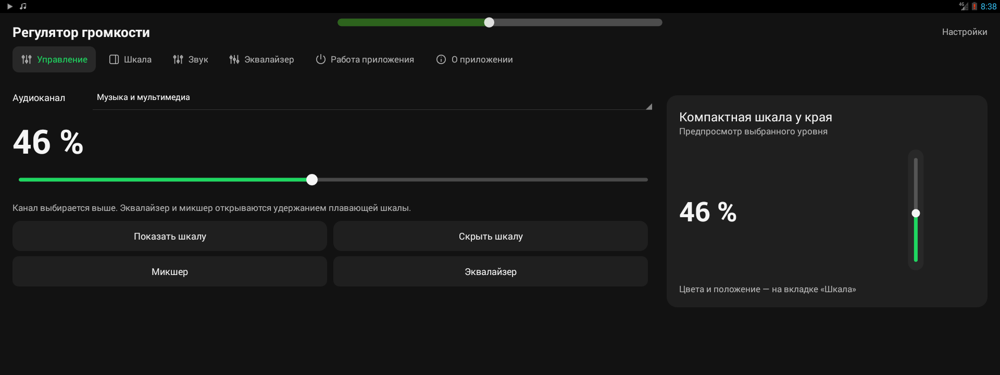
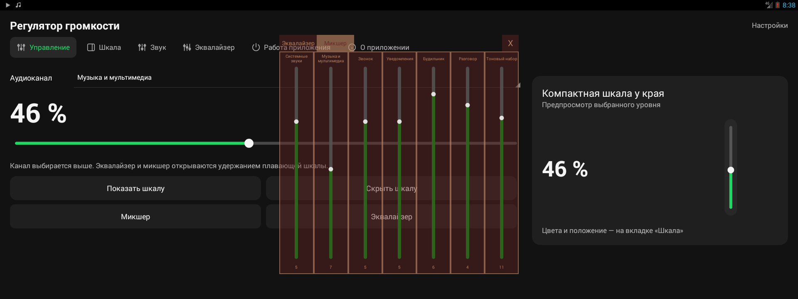
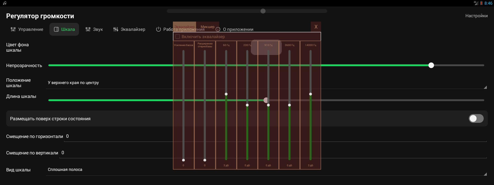
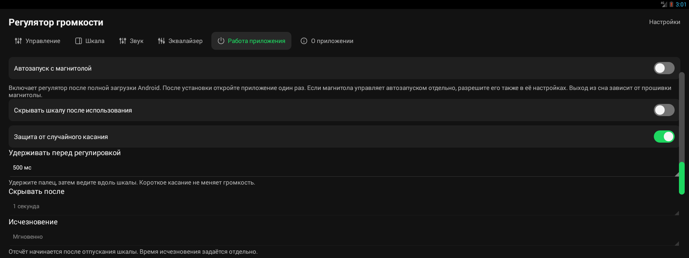
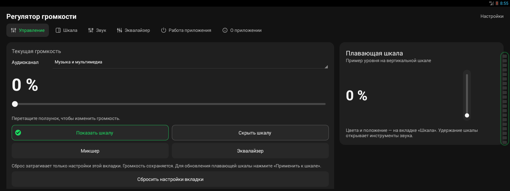
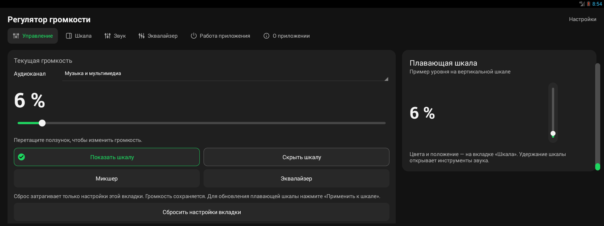

# Регулятор громкости для Geely Coolray

Небольшая плавающая шкала громкости для штатной Android-магнитолы Geely Coolray. Текущий кандидат собирается под Android 4.3 (API 18) и рассчитан на конфигурацию с Community-патчем.

## Скачать приложение

> [!IMPORTANT]
> **[⬇️ Скачать APK последнего тестового выпуска](https://github.com/64kda/geely-coolray-volume-control/releases/latest)**

APK устанавливается вручную на планшет или магнитолу. Скачивание файла само по себе не означает, что приложение принято для автомобиля.

## Возможности текущей сборки

- плавающая вертикальная и горизонтальная шкала;
- настройка положения, размера, длины и стиля индикатора;
- процент рядом со шкалой или в центре;
- защита от случайного касания с задержкой удержания 250/500/1000 мс;
- относительное движение после подтверждения удержания без скачка громкости;
- мягкая подсветка подтверждённого удержания, отключаемая в настройках;
- автоскрытие после запуска и после бездействия;
- основные каналы громкости, EqMix и сохранение настроек.

## Требования

- Android 4.3 или новее, целевая проверка — API 18;
- разрешение показа поверх других окон;
- для полной проверки на автомобиле — штатная магнитола Geely Coolray и безопасный уровень громкости;
- APK подписан тестовым ключом проекта, поэтому обновление поверх другой подписи может потребовать удаления предыдущей версии.

## Скриншоты проверки

Примеры проверенных состояний лежат в [`docs/screenshots/`](docs/screenshots/). Для выпуска нужны снимки настроек, обычной шкалы, сегментированного индикатора, удержания с подсветкой и удержания без неё.

| Основной экран | Микшер | Эквалайзер |
|---|---|---|
|  |  |  |

| Настройки защиты | Удержание подтверждено | Без подсветки |
|---|---|---|
|  |  |  |

Другие разделы: [цвет](docs/screenshots/S-07-color.png) и [сегментированный индикатор](docs/screenshots/S-09-segmented-held.png).

## Статус

Последний кандидат: **redesign15 / code38**. Сборка и проверки API18/DEX прошли. Кандидат проверялся на планшете и реальной магнитоле с установленным Community-патчем; отдельные сценарии автомобиля могут требовать дополнительной проверки.

Подробное ТЗ: [`ТЗ.md`](ТЗ.md). История изменений: [`CHANGELOG.md`](CHANGELOG.md).

## Исходный код

Исходники приложения находятся в [`source/`](source/). Там лежат Java-код,
ресурсы и манифест. Это восстановленный исходный снимок текущего APK; готовый
файл для установки опубликован отдельно в [Releases](https://github.com/64kda/geely-coolray-volume-control/releases).

## Лицензия

Проект распространяется по [PolyForm Noncommercial License 1.0.0](LICENSE).

Разрешены использование, изменения, сборка и распространение в
некоммерческих целях. При публикации форка, изменённой версии или APK нужно
сохранить указание на автора `64kda` и ссылку на [оригинальный репозиторий](https://github.com/64kda/geely-coolray-volume-control),
а также отметить внесённые изменения.

Продажа приложения, коммерческое использование, включение в платную прошивку
или поставка приложения по умолчанию в коммерческом продукте требуют отдельного
письменного разрешения правообладателя.
