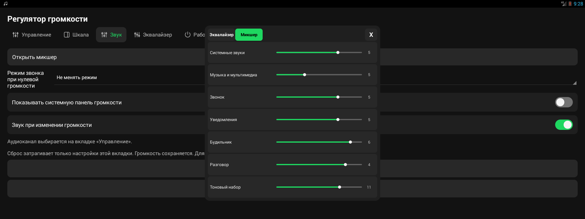
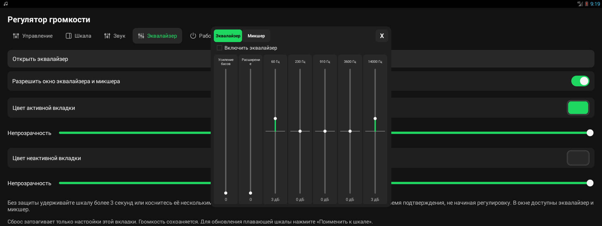
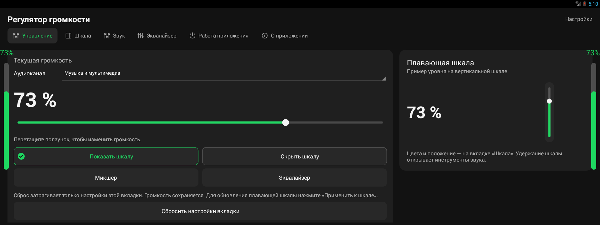
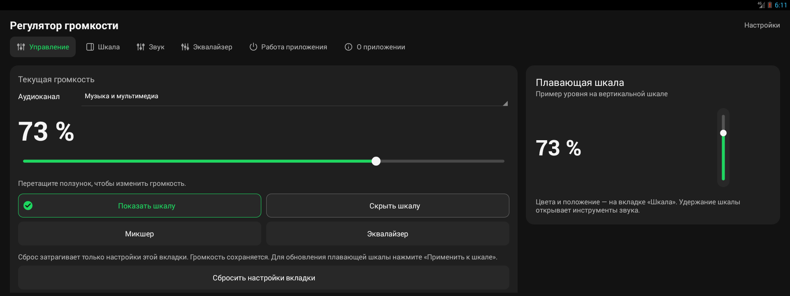

# Регулятор громкости для Geely Coolray

Плавающий регулятор громкости для Android-магнитолы Geely Coolray. Сборка ориентирована на Android 4.3 (API 18).

## Скачать

[Скачать APK 2.7.1-redesign20 (предварительная сборка)](https://github.com/64kda/geely-coolray-volume-control/releases/download/v2.7.1-redesign20/VolumeControl-2.7.1-redesign20-github-candidate.apk)

Это предварительная сборка. APK прошёл локальные проверки и был установлен на эмулятор Android 4.3/API 18 для захвата экранов. Проверка на магнитоле не выполнена. Сертификат совпадает с опубликованной redesign15; APK с другим сертификатом поверх установленной версии не обновится.

## Возможности

- плавающая вертикальная или горизонтальная шкала;
- настройка положения, размера, длины, цвета и стиля;
- защита от случайного касания и настройка автоскрытия;
- режим одной или двух шкал;
- основные каналы громкости и панели EqMix;
- выбор одной из четырёх иконок приложения в настройках «Работа приложения».

## Скриншоты

| Микшер redesign20 | Эквалайзер redesign20 |
|---|---|
|  |  |

Снимки сняты с установленного APK redesign20 на эмуляторе Android 4.3/API 18. Они показывают интерфейс, но не подтверждают работу автомобильного аудио. На этом эмуляторе переключение между вкладками внутри открытой панели закрывает окно; чтобы открыть другую панель, нажмите её кнопку на главном экране. [Метаданные и полный список экранов](docs/SCREENSHOTS.md).

Для сравнения сохранены реальные, но более ранние снимки шкал redesign17:

| Две шкалы | После автоскрытия |
|---|---|
|  |  |

[Эскиз вариантов иконок (не снимок приложения)](https://github.com/64kda/geely-coolray-volume-control/releases/download/v2.7.1-redesign20/production-preview.png).

## Требования

- Android 4.3 (API 18) или новее;
- разрешение показа поверх других окон;
- для проверки автомобильных сценариев — штатная магнитола Geely Coolray и безопасный уровень громкости.

## Лицензия

Проект распространяется по [PolyForm Noncommercial License 1.0.0](LICENSE). Для коммерческого использования требуется письменное разрешение правообладателя.
