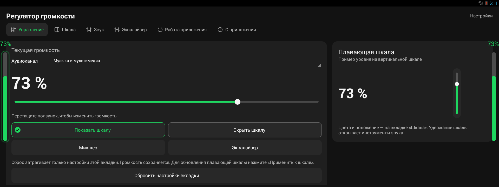
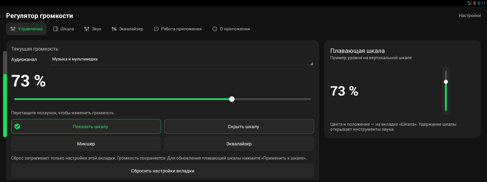
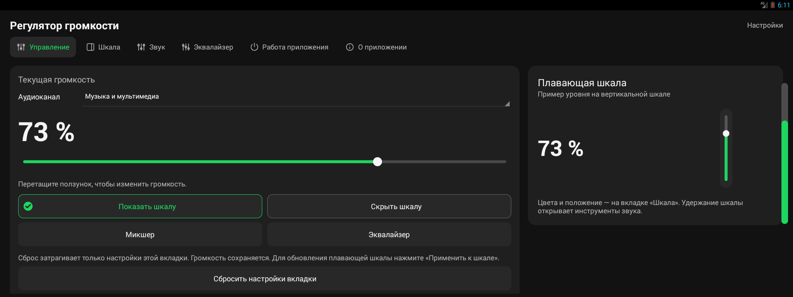
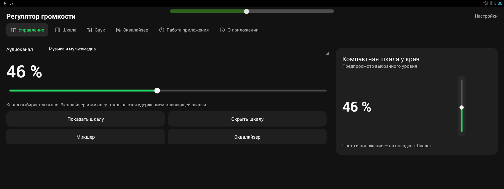
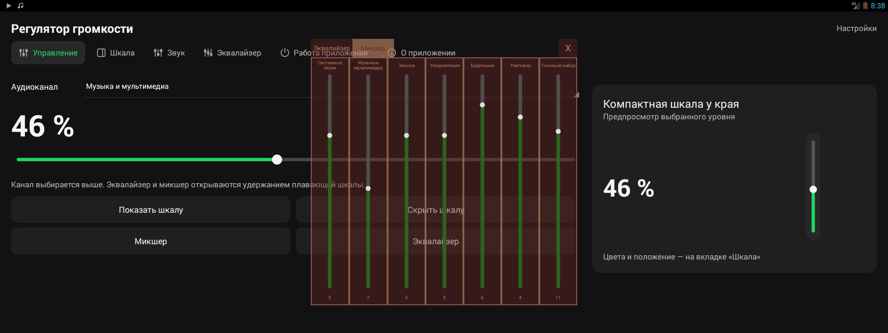
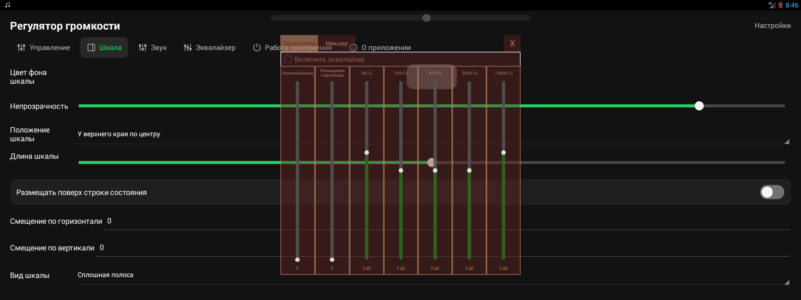
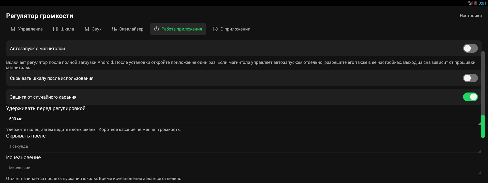
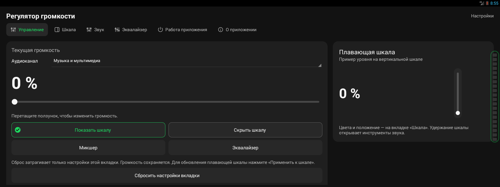
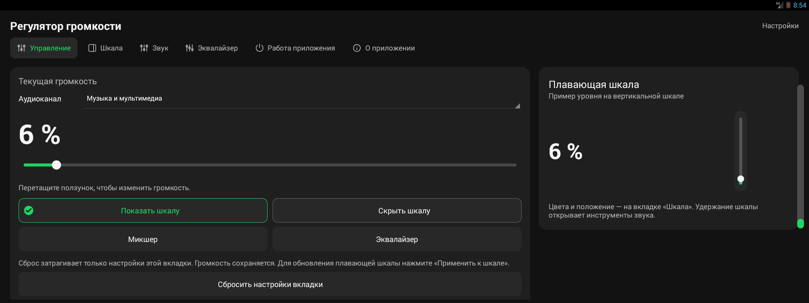

# Регулятор громкости для Geely Coolray

Небольшая плавающая шкала громкости для штатной Android-магнитолы Geely Coolray. Текущий кандидат собирается под Android 4.3 (API 18) и рассчитан на конфигурацию с Community-патчем.

## Скачать приложение

> [!IMPORTANT]
> **[⬇️ Скачать APK 2.7.1 redesign15](https://github.com/64kda/geely-coolray-volume-control/releases/download/v2.7.1-redesign15/VolumeControl-2.7.1-redesign15-guard-feedback-api18.apk)**

APK устанавливается вручную на планшет или магнитолу. Скачивание файла само по себе не означает, что приложение принято для автомобиля.

Опубликованная версия: **redesign15**. В локальном кандидате **redesign17** добавлены шкалы по двум краям экрана и исправлено их автоскрытие. APK redesign17 пока не опубликован.

## Возможности

- плавающая вертикальная и горизонтальная шкала;
- настройка положения, размера, длины и стиля индикатора;
- процент рядом со шкалой или в центре;
- защита от случайного касания с задержкой удержания 250/500/1000 мс;
- относительное движение после подтверждения удержания без скачка громкости;
- мягкая подсветка подтверждённого удержания, отключаемая в настройках;
- автоскрытие после запуска и после бездействия;
- основные каналы громкости, EqMix и сохранение настроек.

В кандидате redesign17 также доступны:

- шкала только слева, только справа или с обеих сторон;
- совместный показ двух шкал при регулировке с общим таймером скрытия либо независимая работа сторон;
- прежние 16 вариантов расположения с сохранением старых настроек;
- исправление автоскрытия левой шкалы и процентов.

После скрытия прозрачная область касания остаётся доступной. В режиме одной стороны второе окно шкалы не создаётся. Эти сценарии проверены на эмуляторе Android 4.3/API18.

## Требования

- Android 4.3 или новее, целевая проверка — API 18;
- разрешение показа поверх других окон;
- для полной проверки на автомобиле — штатная магнитола Geely Coolray и безопасный уровень громкости;
- APK подписан тестовым ключом проекта, поэтому обновление поверх другой подписи может потребовать удаления предыдущей версии.

## Скриншоты redesign17

Снимки собранной redesign17 на эмуляторе Android 4.3/API18, экран 1920×720. [Условия съёмки](docs/SCREENSHOTS-redesign17.md).

| Две шкалы | Удержание с подсветкой |
|---|---|
|  |  |

| Только слева | Только справа |
|---|---|
|  |  |

| Настройки шкалы | После автоскрытия |
|---|---|
|  |  |

### Другие экраны — снимки redesign15

Микшер, эквалайзер и настройки защиты ниже показаны на прежней версии.

| Основной экран | Микшер | Эквалайзер |
|---|---|---|
|  |  |  |

| Настройки защиты | Удержание подтверждено | Без подсветки |
|---|---|---|
|  |  |  |

Другие разделы: [цвет](docs/screenshots/S-07-color.png) и [сегментированный индикатор](docs/screenshots/S-09-segmented-held.png).

## Статус

Опубликованная **redesign15 / code38** проверялась на планшете и реальной магнитоле с Community-патчем; отдельные автомобильные сценарии могут требовать дополнительной проверки.

Кандидат **2.7.1-redesign17 / code40** пересобран и проверен 15.11.2026: локальные тесты, APK/DEX, подпись и целевые сценарии на эмуляторе API18. Установка поверх опубликованной redesign15 прошла. Подпись обновления сохранена.

SHA-256 проверенного APK: `ebbe95fa5082c784b7f9fba4921a9117773ff23a15f88088ee22f46b0da452c0`. Предыдущие отчёты с другими хешами к этому файлу не относятся. [Объём проверок и ограничения](docs/RELEASE-redesign17.md). Проверка redesign17 на магнитоле остаётся открытой.

Подробное ТЗ: [`ТЗ.md`](ТЗ.md). История изменений: [`CHANGELOG.md`](CHANGELOG.md).

## Исходный код

Исходники приложения находятся в [`source/`](source/). Там лежат Java-код,
ресурсы и манифест. Основа восстановлена из APK; изменения кандидата описаны в
[истории изменений](CHANGELOG.md). Опубликованные APK находятся в [Releases](https://github.com/64kda/geely-coolray-volume-control/releases).

## Лицензия

Проект распространяется по [PolyForm Noncommercial License 1.0.0](LICENSE).

Разрешены использование, изменения, сборка и распространение в
некоммерческих целях. При публикации форка, изменённой версии или APK нужно
сохранить указание на автора `64kda` и ссылку на [оригинальный репозиторий](https://github.com/64kda/geely-coolray-volume-control),
а также отметить внесённые изменения.

Продажа приложения, коммерческое использование, включение в платную прошивку
или поставка приложения по умолчанию в коммерческом продукте требуют отдельного
письменного разрешения правообладателя.
