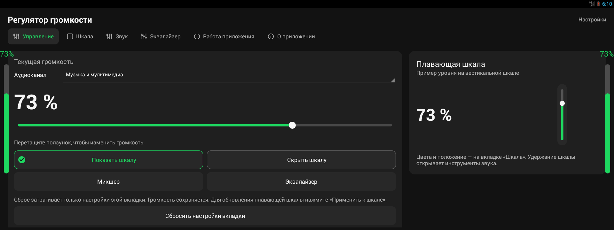

# 2.7.1-redesign20 — предварительная сборка

[Скачать APK](https://github.com/64kda/geely-coolray-volume-control/releases/download/v2.7.1-redesign20/VolumeControl-2.7.1-redesign20-github-candidate.apk)

В этой версии можно выбрать одну из четырёх иконок приложения: 6, 7, 8 или 10. По умолчанию выбрана иконка 7. Выбор перенесён в раздел «Работа приложения», а дублирующая кнопка в верхней части экрана удалена. Также в интерфейсе добавлены кнопки перехода к микшеру и эквалайзеру. Оба окна открыты на эмуляторе API 18; работу аудио не проверяли. Встроенное переключение между панелями закрывает окно; чтобы сменить панель, используйте кнопку на главном экране.

В сборке сохранены шкалы с двух сторон экрана и совместное автоскрытие, добавленные после redesign15. Эти функции прошли локальные проверки; redesign17 ранее проверялся на эмуляторе API 18. Redesign20 установлена на API18-эмулятор для проверки отображения панелей. Реакция аудио и работа на магнитоле не проверены.

APK: `2.7.1-redesign20`, `versionCode 43`, Android 4.3/API 18 и выше. Сертификат подписи совпадает с опубликованной redesign15. APK с другим сертификатом поверх установленной версии не обновится.

Размер APK: 2 680 513 байт. SHA-256: `0e955d23540666a06b469b36a5f5c874e752ed73dc3534d35f8cef37ee78f201`.

## Скриншоты redesign20 — Android 4.3/API 18

Снимки шкал ниже относятся к redesign17 и оставлены для сравнения.

## Проверки и ограничения

- локальные тесты логики шкал, защиты от касаний, автоскрытия, видимости иконок и APK прошли;
- подпись APK проверена для схем v1, v2 и v3;
- окна микшера и эквалайзера открыты на API18-эмуляторе и сняты; внутренняя вкладка переключения закрывает окно — используйте кнопку соответствующей панели на главном экране; аудио и магнитола не проверены;
- при смене иконки ярлык на домашнем экране может переместиться или устареть; это поведение не исправлено и не проверено на лаунчере магнитолы.
