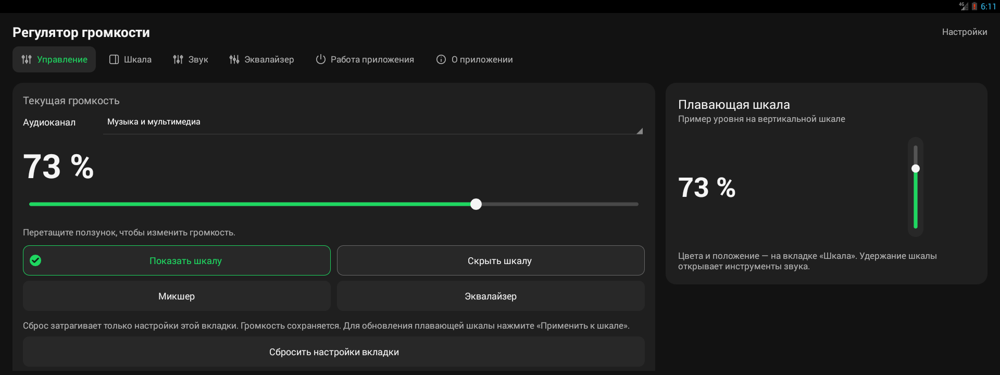

## Что изменилось

В настройках «Работа приложения» появился выбор иконки: доступны варианты 6, 7, 8 и 10; по умолчанию выбрана 7. Удалена отдельная кнопка выбора иконки в верхней части экрана. В интерфейсе добавлены кнопки перехода к микшеру и эквалайзеру. Оба окна открыты на эмуляторе API 18; работа аудио не проверялась.

Изменения шкал с двух сторон экрана и совместного автоскрытия уже находятся в `main` после PR #1.

## Проверки

Локально прошли тесты моделей шкал и автоскрытия, защиты от касаний, видимости, ресурсов и выбора иконок. APK собран как `2.7.1-redesign20` (`versionCode 43`); подписи v1/v2/v3 проверены.

## Скриншоты

Дополнительно приведён один исторический снимок шкал redesign17. Эскиз вариантов иконок приложен отдельно.

## Ограничения

redesign20 установлена на эмулятор API 18; оба окна открыты и сняты. Встроенное переключение между панелями закрывает окно, поэтому для смены панели нужно вернуться к кнопке в основном экране. Звук и работу на магнитоле не проверяли. При смене иконки закреплённый ярлык может переместиться или устареть; исправление не входит в этот PR.
