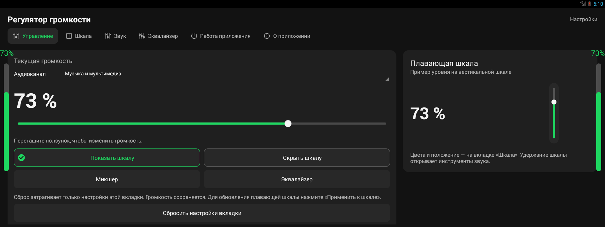
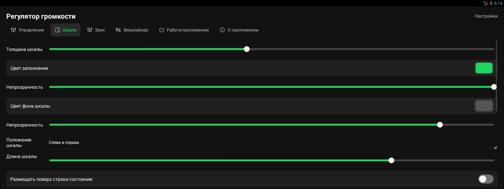

## Что изменилось

В настройках «Работа приложения» появился выбор иконки: доступны варианты 6, 7, 8 и 10; по умолчанию выбрана 7. Удалена отдельная кнопка выбора иконки в верхней части экрана. В интерфейсе добавлены кнопки перехода к микшеру и эквалайзеру; их запуск на устройстве не проверен.

Изменения шкал с двух сторон экрана и совместного автоскрытия уже находятся в `main` после PR #1.

## Проверки

Локально прошли тесты моделей шкал и автоскрытия, защиты от касаний, видимости, ресурсов и выбора иконок. APK собран как `2.7.1-redesign20` (`versionCode 43`); подписи v1/v2/v3 проверены.

## Скриншоты

Снимки шкал ниже сделаны на redesign17 и показывают прежнее поведение. Они не демонстрируют новые настройки иконок. Эскиз вариантов иконок приложен отдельно.

## Ограничения

Новая сборка не установлена на эмулятор или магнитолу, поэтому её интерфейс и поведение при запуске не подтверждены. При смене иконки закреплённый ярлык может переместиться или устареть; исправление не входит в этот PR.
