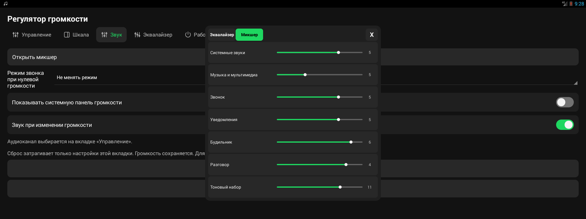
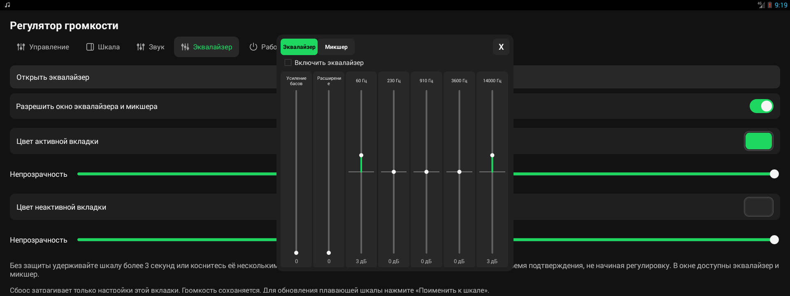

# Скриншоты приложения

## Микшер и эквалайзер — redesign20

Сняты 25.11.2026 с установленным APK `VolumeControl-2.7.1-redesign20-github-candidate.apk`, версия `2.7.1-redesign20`, `versionCode 43`. Устройство: эмулятор `Coolray_FirmwareLab`, Android 4.3.1/API 18, `armeabi-v7a`, 1920×720, 160 dpi. PNG получены командой Android `screencap`; изображение не дорисовывалось и не обрезалось.

| Экран | Снимок |
|---|---|
| Микшер — открыто окно с каналами громкости |  |
| Эквалайзер — флажок включения оставлен выключенным |  |

Снимки подтверждают отображение панелей и открытие окон на API 18. При нажатии на внутреннюю вкладку перехода окно закрывается вместо смены панели; чтобы открыть другую панель, используйте её кнопку на главном экране. Работа аудио и автомобильная приёмка не проверялись.

## Шкалы — исторические снимки redesign17

Сняты 15.11.2026 на отдельном эмуляторе Android 4.3/API 18, 1920×720. Это прежняя версия интерфейса шкал; новые настройки иконок на этих снимках не показаны. [Полная галерея и условия съёмки redesign17](SCREENSHOTS-redesign17.md).
