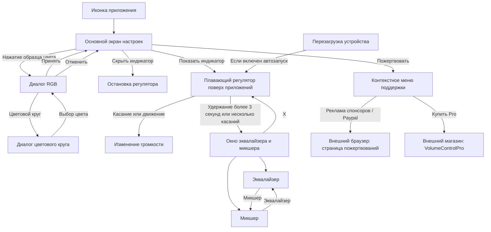

# Карта «Регулятора громкости» 2.7.1

Карта восстановлена из APK, без запуска на Android. Это карта логики и элементов интерфейса, а не подтвержденный скриншотами обход приложения. Число полос эквалайзера и поддержка эффектов зависят от устройства.

## Сравнение двух файлов

`E:/Регулятор+громкости+v2.7.1.apk` и `E:/rubberbigpepper.volumecontrol-23.apk` имеют одинаковый размер 2 288 449 байт и SHA-256:

`64b25aeaef78b398b14c6171df93d01e82bae9f34fda78277b7bc14c72f86d1f`

Различий в содержимом не обнаружено. Различаются имена файлов.

Пакет: `rubberbigpepper.VolumeControl`; версия: `2.7.1`; versionCode: `23`; minSdk: `3`; targetSdk: `14`. Основная Activity: `MainWindow`. Два launcher-alias ведут в эту же Activity; это не два разных экрана и не доказательство наличия платной версии. При запуске код выбирает Free-alias по имени пакета.

## Общая схема

Вход в окно эквалайзера и микшера зависит от флажка «Включить окно эквалайзера/микшера». При включенной секундной задержке порог удержания увеличивается на эту задержку. Обработка удержания зависит от поступления touch-событий; поведение неподвижного пальца нужно проверить на устройстве. На API ниже 9 код скрывает вкладку эквалайзера и открывает микшер.

## Основной экран: порядок сверху вниз

Это одна длинная прокручиваемая форма, а не набор отдельных разделов. Ниже приведены смысловые группы для поиска настроек.

| Группа | Что находится на экране | Действие |
|---|---|---|
| Внешний вид индикатора | Размер; цвет; прозрачность; цвет фона; прозрачность фона | Ползунки и диалоги цвета |
| Положение | Расположение; длина; «Использовать строку состояния»; сдвиги X и Y | Выбор привязки и геометрии |
| Управление звуком | Тип ползунка; канал; действие при нулевой громкости | Выпадающие списки |
| Обратная связь | «Показать уведомление»; «Звуковое уведомление» | Системная индикация громкости и звук при регулировке |
| Поведение | Секундная пауза; скрытие после использования | Флажки |
| Эквалайзер и микшер | Разрешить окно; активный и неактивный цвета, их прозрачность | Флажок раскрывает настройки цветов окна |
| Запуск | Запускать после перезагрузки | Флажок автозапуска |
| Нижняя панель | Показать индикатор; скрыть индикатор; пожертвовать | Управление службой и внешние переходы |

Название «Показать уведомление» неоднозначно: в `SetVolume` оно управляет флагом показа системного UI громкости. Постоянное уведомление фоновой службы реализовано отдельно.

### Варианты выбора

- Расположение: 16 вариантов; четыре вдоль всей стороны экрана и 12 привязок к краям и углам.
- Тип ползунка: два варианта; в базовых ресурсах `Solid bar` и `Volume bar`.
- Канал: автовыбор, все каналы, музыка и мультимедиа, система, звонок телефона, оповещение, разговор, будильник, тоновый набор.
- Нулевая громкость: не изменять режим, вибрация, беззвучный режим.

Автовыбор в коде учитывает режим AudioManager и воспроизведение музыки: музыка → мультимедиа; обычный режим без музыки → звонок; телефонный разговор → канал разговора. Это простая эвристика, ее работу с современными VoIP-приложениями следует проверить отдельно.

Показ настройки действия при нуле непоследователен: при выборе канала и при загрузке формы используются разные условия. Поэтому ее доступность после повторного открытия может отличаться; см. список доработок.

## Плавающий регулятор

1. Открыть приложение. `onCreate` сам сохраняет настройки и отправляет команду запуска службы.
2. При необходимости выбрать канал и положение.
3. Нажать «Показать индикатор».
4. Работать с регулятором поверх другого приложения: касание и движение задают уровень по координате.
5. Для эквалайзера/микшера использовать удержание или несколько касаний при включенной соответствующей настройке.
6. Кнопка `X` закрывает дополнительное окно. «Скрыть индикатор» в главной форме отправляет команду остановки службы.

Автоскрытие уменьшает прозрачность отрисовки. В этом обработчике окно не удаляется: невидимая область потенциально продолжает принимать касания. Это требует проверки на телефоне.

## Окно эквалайзера и микшера

| Элемент | Содержимое | Возврат |
|---|---|---|
| Эквалайзер | Полосы, полученные от системного эффекта; частоты в Hz, усиление в dB; флажок включения; басы и стереобаза при поддержке | Вкладка «Микшер» или `X` |
| Микшер | Семь отдельных каналов: система, музыка, звонок, уведомления, будильник, разговор, DTMF | Вкладка «Эквалайзер» или `X` |
| `X` | Закрывает дополнительное плавающее окно | Возвращает доступ к индикатору |

## Выбор цвета

Четыре точки входа: цвет индикатора, фон, активный цвет окна, неактивный цвет окна.

`Образец цвета → RGB (красный/зеленый/синий и предпросмотр) → Принять / Отменить`.

В RGB-диалоге кнопка «Цветовой круг» открывает еще один диалог. Выбор в нем обновляет RGB-диалог; окончательное принятие выполняется там. Нажатие на образец в RGB-диалоге тоже принимает цвет.

## Поддержка и внешние переходы

Кнопка «Пожертвовать» открывает три пункта:

1. «Кликнуть на рекламу спонсоров» → URL пожертвований.
2. «Пожертвовать через Paypal/Google checkout» → тот же URL.
3. «Купить Pro версию в маркете» → `market://details?id=rubberbigpepper.VolumeControlPro`.

В текущем пакете код создает рекламный баннер. Наличие рекламных и Google Play Services классов не означает наличие пользовательского входа в аккаунт, оплаты внутри приложения или отдельных экранов авторизации. Работоспособность внешних ссылок и загрузка рекламы не проверялись.

## Техническая карта для разработчика

| Узел | Файл после декомпиляции | Ответственность |
|---|---|---|
| Главный экран | `analysis/java/rubberbigpepper/VolumeControl/MainWindow.java` | Настройки, запуск/остановка, цвета, поддержка |
| Плавающие окна | `analysis/java/rubberbigpepper/CommonCtrl/VolumeControlService.java` | Окно регулятора, звук, эквалайзер, микшер |
| Жесты | `analysis/java/rubberbigpepper/CommonCtrl/ZoomView.java` | Касания, уровень, удержание, отрисовка |
| Цвета | `RGBColorPickerDialog.java`, `ColorPickerDialog.java` | RGB и цветовой круг |
| Автозапуск | `analysis/java/rubberbigpepper/CommonCtrl/CRebootReceiver.java` | Реакция на перезагрузку |
| Поддержание службы | `FakeService.java`, `AndroidNeverKillBroadcast.java` | Старый механизм фоновой работы и перезапуска |
| Макеты | `analysis/res/layout/main.xml`, `equalizer.xml`, `color_picker.xml`, `onebar.xml` | Структура формы и дополнительных окон |

Декомпилированный Java содержит артефакты восстановления типов и управления потоком. Это материал для исследования, а не готовый к сборке исходный проект. Для ключевых условий дополнительно изучен Dalvik-листинг `analysis/app-code-0.txt`.
